# FM — Total Commander for Linux

Dual-panel file manager inspired by Total Commander, written in C with GTK4.

## Screenshots

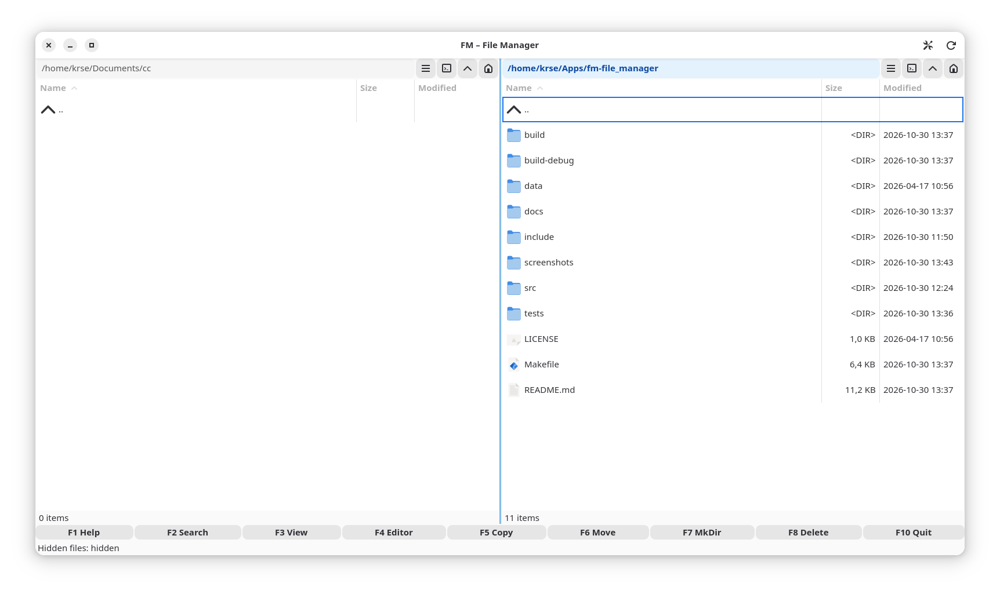

| | |
|:---:|:---:|
| 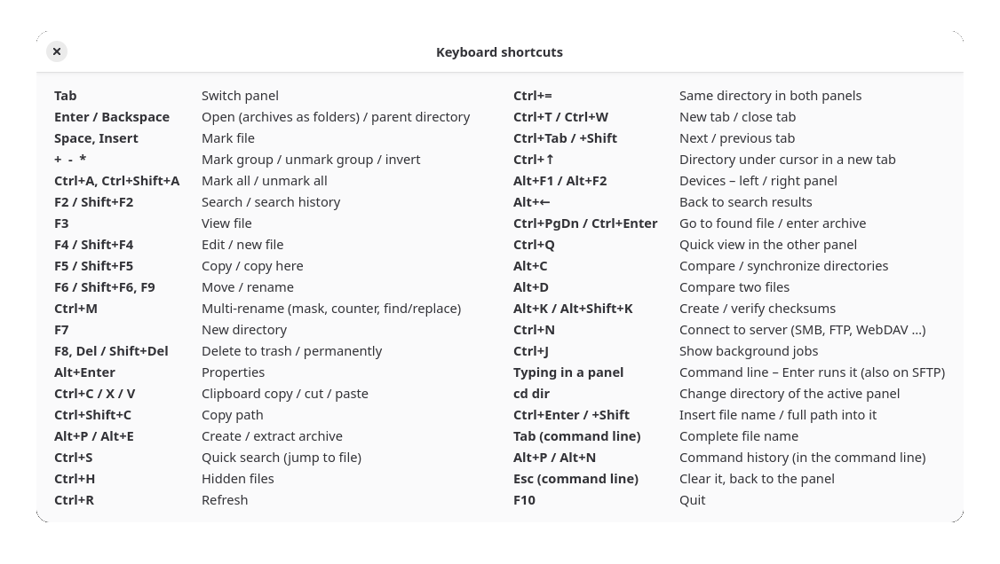 | 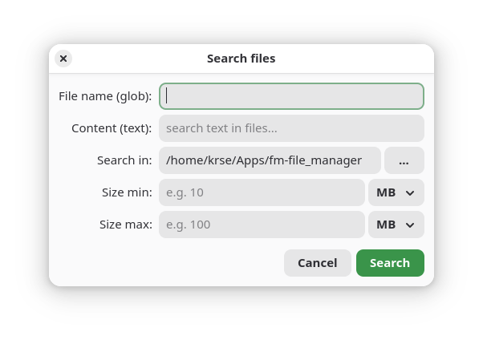 |
| F1 — keyboard shortcuts | F2 — search files |
| 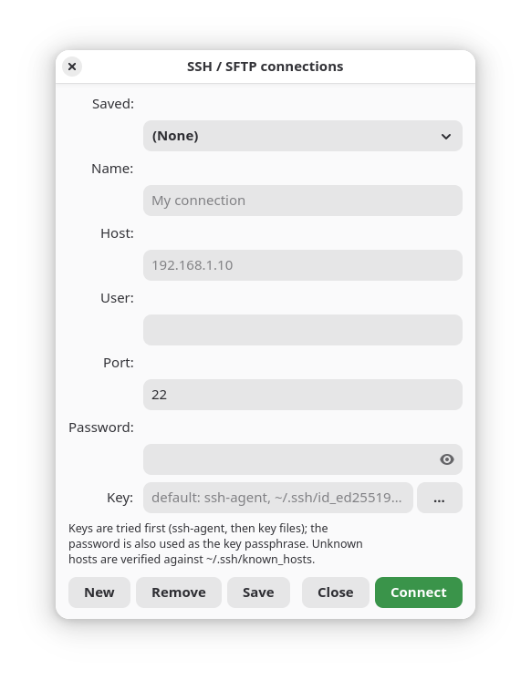 | 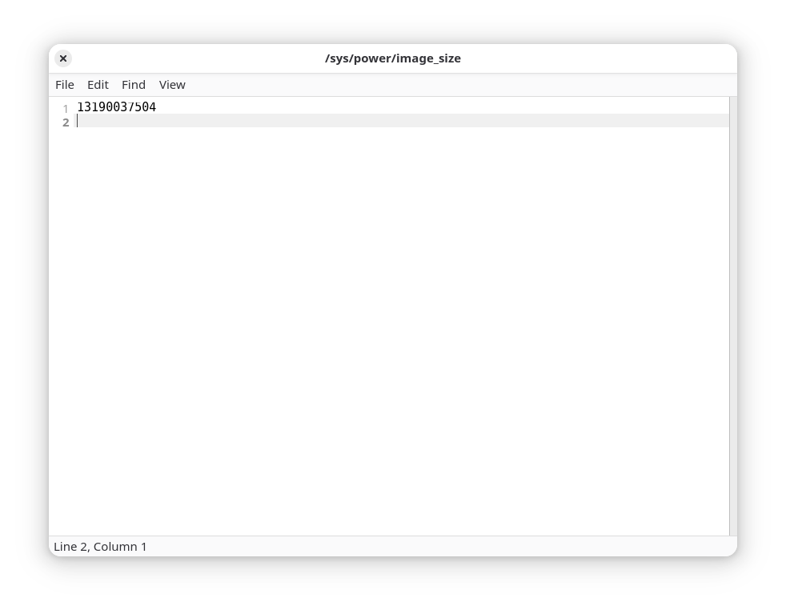 |
| SSH / SFTP connections | F4 — editor |
| 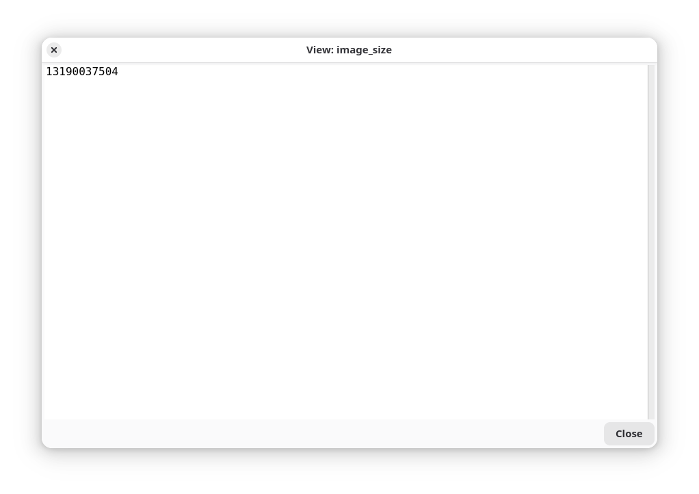 | 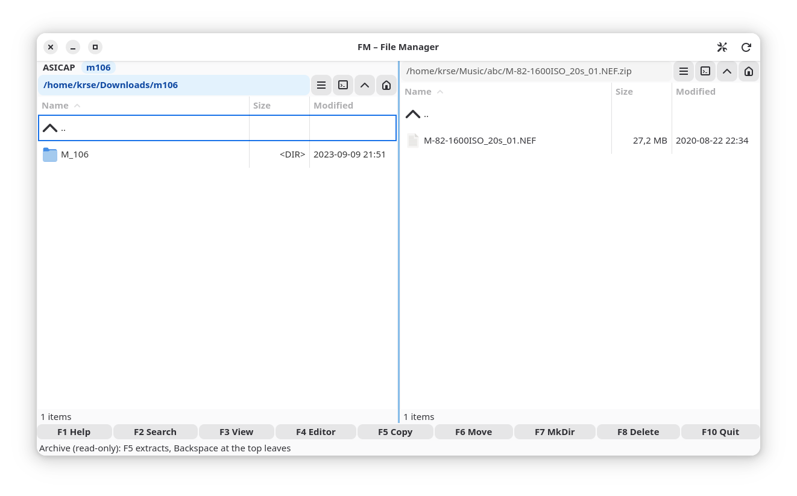 |
| F3 — viewer | Tabs (left) and a zip archive opened as a directory (right) |
| 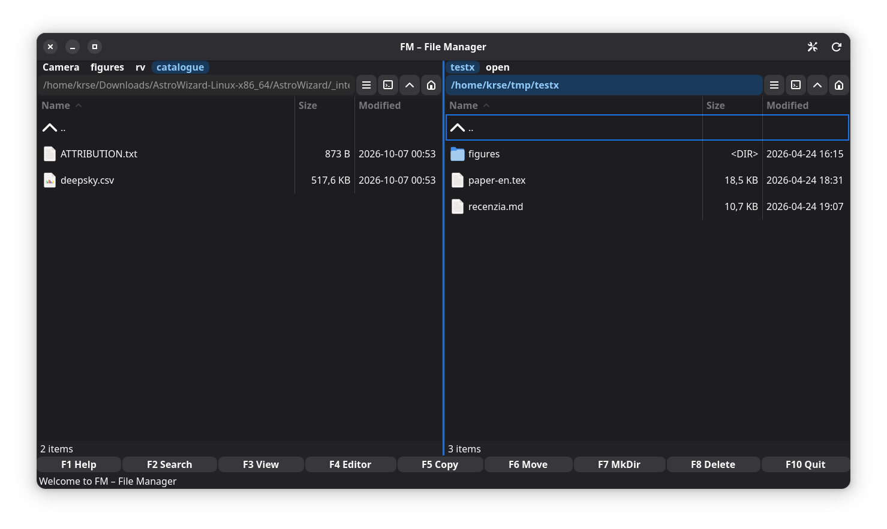 | 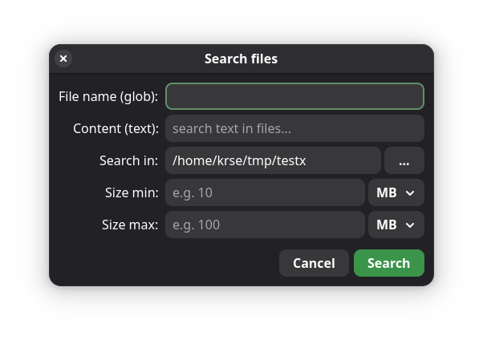 |
| Dark theme with tabs in both panels | F2 — search by name, content and size |
| 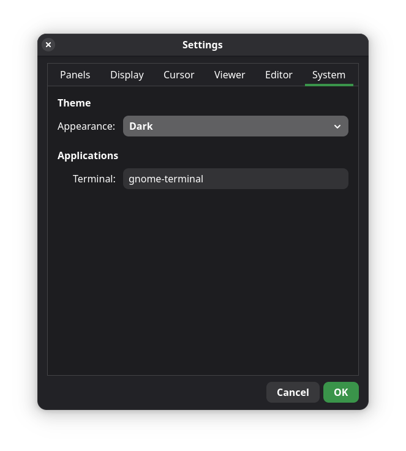 | 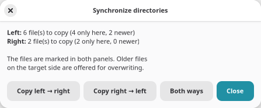 |
| Settings — theme and terminal | Alt+C — synchronize after comparing |
| 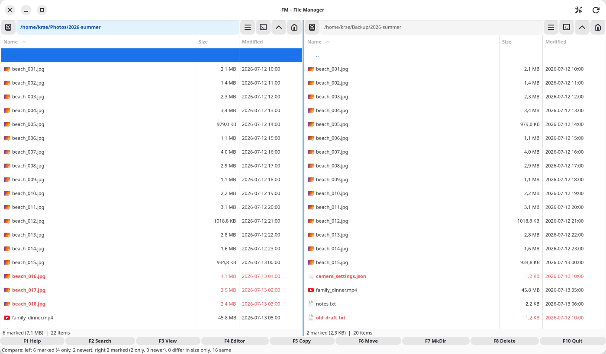 | 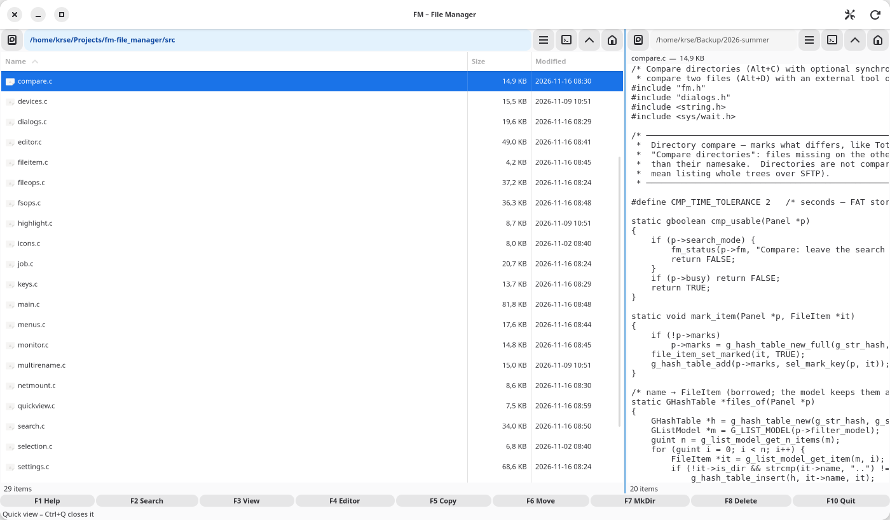 |
| Alt+C — compare directories: missing and newer files marked in both panels | Ctrl+Q — quick view of the file under the cursor in the other panel |
| 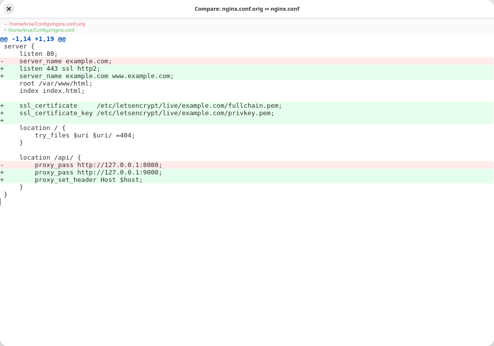 | 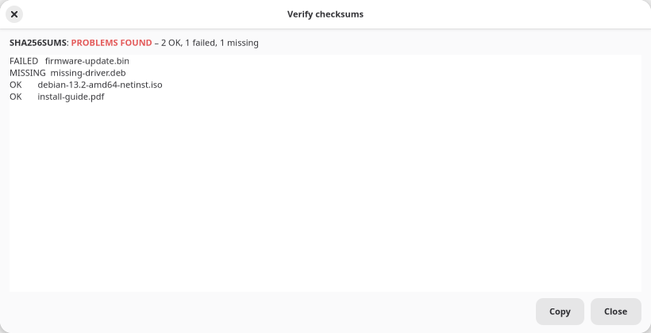 |
| Alt+D — compare two files (built-in diff, or meld / kdiff3) | Alt+Shift+K — verify a checksum file, problems listed first |
| 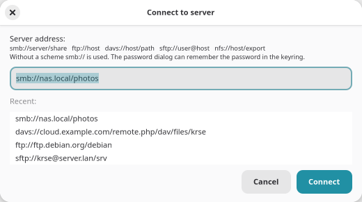 | 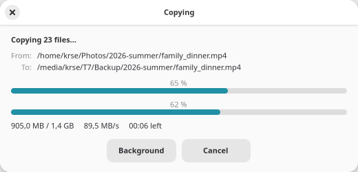 |
| Ctrl+N — connect to SMB, FTP, WebDAV, NFS … | Copy with the Background button – keep working, Ctrl+J shows it again |

## Features

- **Two panels** — navigation like in Total Commander
- **Tabs** — Total Commander style tabs per panel: Ctrl+T new, Ctrl+W close, Ctrl+Tab / Ctrl+Shift+Tab switch, Ctrl+↑ opens the directory under the cursor in a new tab; click a tab to switch, middle-click to close; the tab strip appears with 2+ tabs; tabs work on SFTP panels too — a new tab shares the connection (tab label `host:dir`), each tab keeps its own remote directory, Disconnect returns every tab of that connection to its local directory; tabs are saved right after every change and restored on the next start (SFTP tabs as their local directory)
- **Devices** — drive button left of the path bar (Alt+F1 left panel, Alt+F2 right panel), like Double / Total Commander: File System, Home, mounted devices and not-yet-mounted volumes (USB sticks, partitions, encrypted disks, phones); Enter / click mounts (asks for a passphrase when needed) and opens it, ⏏ or Del unmounts / ejects; newly plugged devices are announced in the command line, panels on a removed device move to Home
- **Editable path** — path entry at the top of each panel, Enter loads directory, supports ~ and relative paths
- **SFTP panel** — connect to a remote server via SSH/SFTP (libssh2), async connect (non-blocking UI); host keys verified against `~/.ssh/known_hosts`; ssh-agent, ed25519/ecdsa/rsa keys, encrypted keys, password and keyboard-interactive auth; IPv4 + IPv6
- **File marking** — Insert/Space or Shift+arrows mark files; `+`/`-` select/unselect group by pattern (`*.c;*.h`), `*` inverts, Ctrl+A all; status bar shows count and total size of marked files
- **Copy, move, delete** — Total Commander style: F5 → path of the other panel is pre-selected, Enter starts copying (type `dir/newname` to rename a single item); F8 → Yes/No confirmation; operations run in a background thread with a From/To progress window (current file + total bar, speed, time left, Esc = cancel); overwrite prompt (Overwrite / Overwrite all / Skip / Skip all / Cancel); permissions, timestamps and symlinks preserved; directories merged; copying a directory into itself is refused; full recursive SFTP support incl. remote-to-remote
- **Refine… (filtered copy / move / delete)** — the F5, F6 and F8 dialogs have a *Refine…* button (Alt+R) that opens a pattern editor in `.gitignore` syntax: `*.o`, `build/` (directories only), `/top` (top level only), `docs/**/*.tmp`, `!keep.o` (re-include), `#` comments; patterns are relative to the directory of the selected items. Two modes: **Leave out matching** (Alt+L, like `.gitignore` – matching items are not touched) and **Only matching** (Alt+O, the negation – only matching items are processed, a matched directory with all its content). The last patterns and mode are remembered separately for copy, move and delete and prefilled next time, but they **apply only when Refine… is pressed** in that dialog – otherwise the operation runs unfiltered. Directories that keep excluded items stay in the source, empty ones are not created at the target; Ctrl+Enter in the editor starts the operation; the status line reports how many items were left out. Works locally and over SFTP
- **Multi-rename** — Ctrl+M on marked files: name mask with `[N]` name, `[E]` extension, `[C]` counter (start, step, digits), find/replace, lower/upper case, live preview of old → new names; conflicts are detected before anything is renamed and swaps (a↔b) work (local files)
- **Trash** — F8/Del moves local files to the trash (freedesktop), Shift+Del / Shift+F8 deletes permanently
- **Clipboard** — Ctrl+C / Ctrl+X / Ctrl+V interoperable with other file managers (Nautilus, Dolphin, …); paste into an SFTP panel uploads
- **Context menu** — right click on a file: **Open with** (default application, other registered applications, or "Other application…" from the system chooser), copy, cut, paste, duplicate, rename, delete, new folder/file, properties, selection
- **Properties** — Alt+Enter: size (directories computed in background), owner, dates, symlink target, editable permissions (also over SFTP)
- **New file / duplicate** — Shift+F4 creates a file and opens the editor; Shift+F5 copies in place under a new name; F7 accepts nested paths (`a/b/c`)
- **Archive support** — extract and create archives (tar.gz, tar.bz2, tar.xz, tar.zst, zip, 7z, rar)
- **Archives as directories** — Enter (or Ctrl+PgDn) on a zip/jar/tar.*/7z/iso/rar/cpio browses it read-only like a directory; F5 extracts the selected files (progress, overwrite prompts), Enter/F3/F4 on a file opens a temporary copy, Backspace at the top leaves the archive; needs libarchive (without it Enter opens the archive in its default application)
- **Incremental search** — Ctrl+S, MC-style jump-to-file search (cursor jumps to matching file, list not filtered)
- **File mask** — glob pattern display filter on active panel (files only, e.g. `*.c`)
- **File search** — F2, recursive search with content grep, size filter, MC-style grouped results in panel. Results are kept: Enter opens a file in its default app, Ctrl+PgDn / Ctrl+Enter jumps to the file's directory, Alt+← (or the 🔍 button) returns to the results, Shift+F2 lists the last 10 searches. Content search shows `:line  matching text` next to each file; F3 opens the viewer on that match with the text highlighted (F3 / Shift+F3 = next / previous)
- **File viewer** — F3, displays text (only the first 50 MB of larger files are read, also over SFTP, so even multi-GB files open instantly) with configurable font and search (Ctrl+F); image preview for PNG/JPG/GIF/SVG/WebP/BMP/TIFF (toggleable in Settings)
- **Text editor** — F4, built-in editor with menu bar, find/replace (Ctrl+F/H), syntax highlighting; works on SFTP panel too (saving runs in the background with a "Saving…" window); files up to 100 MB (larger remote files are refused without being downloaded)
- **Syntax highlighting** — GtkSourceView (hundreds of languages) or built-in highlighter (C/Python/Shell/JS); switched off automatically for files over 2 MB to keep large files fast
- **Content-type icons** — files and folders shown with freedesktop standard icons based on extension (~80 types)
- **Command line** — Midnight Commander style, above the F-key bar: typing in a panel goes there, Enter runs the command with `sh -c` in the active panel's directory without a terminal (on an SFTP panel it runs on the server over the same SSH connection); both panels are refreshed afterwards; `cd dir` changes the panel's directory; a `user@host$` prompt (`#` as root, the server's user and host on an SFTP panel) stands in front of it and the line itself shows only what you type; Ctrl+Enter / Ctrl+Shift+Enter insert the file name / full path under the cursor, Tab completes file names, Alt+P / Alt+N browse the history (saved owner-only in `~/.config/fm/cmd_history`)
- **SSH terminal** — open terminal directly in the current directory (local and SSH)
- **Saved SSH connections** — any number of named connections (name/host/user/port/key) in settings.ini, selectable via dropdown; Save with a new name adds a connection, the same name updates it, New clears the form, Remove deletes the selected one; custom private key path per connection
- **Auto-refresh panels** — automatic directory monitoring via inotify (local) or polling (SFTP, interval 1–300 s in Settings, default 5 s); incremental updates in batches (add/remove/update individual files in one pass, no full reload); a mass copy into the shown directory causes one reload, then updates back off to 1 s
- **Compare / synchronize directories** — Alt+C marks in both panels the files that are missing on the other side or newer (2 s tolerance for FAT); then copy left → right, right → left or both ways in one step (local and SFTP); files with the same time but a different size are reported, not marked
- **Compare files** — Alt+D on two marked files or the cursor file of each panel: opens meld / kdiff3 / kompare / diffuse (or the program set in Settings → System → Compare tool), otherwise a built-in coloured unified diff
- **Quick view** — Ctrl+Q shows the file under the cursor in the other panel: text (first 512 KB), images (decoded in the background, downscaled to 2048 px), directory summary; follows the cursor, the panel widths stay as they were
- **Background operations** — local copy / move / delete can be sent to the background ("Background" button in the progress window); further operations queue up behind it, the command line shows the progress, Ctrl+J shows the window again; closing the main window waits for running jobs
- **Checksums** — Alt+K creates MD5 / SHA-1 / SHA-256 / SHA-512 sums of the marked files (directories recursively, scanned inside the progress window with Cancel), copy them or save as `.sha256` …; Alt+Shift+K verifies a checksum file (GNU and BSD format) and lists failed / missing files first
- **Network locations** — Ctrl+N connects to `smb://`, `ftp://`, `dav(s)://`, `sftp://`, `nfs://` … through GIO/gvfs (password dialog, keyring); the panel opens the gvfs FUSE path, so every operation works there; last 10 addresses remembered; ⏏ in the device picker disconnects (needs gvfs + gvfs-fuse, standard on GNOME/Xfce/Cinnamon)
- **Remembered window size** — the main window opens with the size (and maximized state) it had when it was last closed
- **Per-panel hamburger menu** — New/Close tab, SSH/SFTP, Create/Extract archive, File mask, Search, Filter — in each panel's path bar
- **Dark / Light / System theme** — runtime switching via Settings → System (libadwaita); "System" follows the desktop light/dark setting and switches live when it changes; colors auto-adapt (directories, symlinks, marks, editor scheme)
- **Settings** — tabbed dialog: Panels / Display / Cursor / Viewer / Editor / System

## Keyboard shortcuts

### Panel
| Key | Action |
|-----|--------|
| Tab | Switch active panel |
| Enter | Open file/directory (or confirm path in path entry) |
| Escape | Cancel path editing / close filter |
| Backspace | Go up one level |
| Space / Insert | Mark file + move cursor |
| Shift+Up / Shift+Down | Mark while moving |
| + / Num+ | Select group (pattern) |
| - / Num- | Unselect group |
| * / Num* | Invert selection |
| Ctrl+A / Ctrl+Shift+A | Mark all / unmark all |
| Ctrl+C / Ctrl+X / Ctrl+V | Copy / cut / paste (system clipboard) |
| Ctrl+Shift+C | Copy full path(s) as text |
| Alt+Enter | Properties / permissions |
| Right click | Context menu |
| F1 | Keyboard shortcut help |
| F2 | Search files |
| Shift+F2 | Search history (last 10 searches) |
| Ctrl+PgDn / Ctrl+Enter | In results: go to the file's directory |
| Enter / Ctrl+PgDn on an archive | Browse the archive like a directory (read-only; F5 extracts) |
| Alt+← | Back to the last search results |
| F3 | View file |
| F4 | Text editor |
| Shift+F4 | New file (opens editor) |
| F5 | Copy |
| Shift+F5 | Duplicate in the same directory |
| F6 | Move |
| Shift+F6 / F9 | Rename |
| Ctrl+M | Multi-rename marked files |
| F7 | New directory (nested `a/b/c` allowed) |
| F8 / Del | Delete (local: move to trash) |
| Alt+R in the F5 / F6 / F8 dialog | Refine… – filter this one operation (`.gitignore` patterns) |
| Shift+F8 / Shift+Del | Delete permanently |
| F10 | Quit |
| Ctrl+S | Incremental search (MC-style jump to file) |
| Ctrl+H | Hidden files |
| Ctrl+R | Refresh both panels |
| Ctrl+= | Synchronize panels |
| Ctrl+T / Ctrl+W | New tab (current directory) / close tab |
| Ctrl+Tab / Ctrl+Shift+Tab | Next / previous tab |
| Ctrl+↑ | Open directory under cursor in a new tab (also on SFTP) |
| Alt+F1 / Alt+F2 | Devices for the left / right panel |
| Alt+E | Extract archive |
| Alt+P | Create archive (pack) |
| Ctrl+Q | Quick view in the other panel |
| Alt+C | Compare / synchronize directories |
| Alt+D | Compare two files |
| Alt+K / Alt+Shift+K | Create / verify checksums |
| Ctrl+N | Connect to server (SMB, FTP, WebDAV …) |
| Ctrl+J | Show background jobs |

### Command line
| Key | Action |
|-----|--------|
| Typing in a panel | Goes to the command line (`+ - *` and Space keep their panel meaning while it is empty) |
| Enter | Run the command (in the background, also on SFTP); `cd dir` changes directory |
| Ctrl+Enter / Ctrl+Shift+Enter | Insert file name / full path under the cursor |
| Tab | Complete file name |
| Alt+P / Alt+N | Previous / next command from the history |
| ↑ ↓ PgUp PgDn Insert | Still move / mark in the panel |
| Esc | Clear the command line |

### Editor / Viewer
| Key | Action |
|-----|--------|
| Ctrl+S | Save (editor) |
| Ctrl+F | Find |
| Ctrl+H | Replace (editor only) |
| F3 | Find next |
| Shift+F3 | Find previous |
| Escape | Close search panel |

## Requirements

- GTK4 (>= 4.12)
- GLib 2.x
- libadwaita-1 (optional — for runtime dark/light theme switching)
- libssh2 (optional — for SFTP panel)
- gtksourceview-5 (optional — for full syntax highlighting)
- libarchive (optional — for browsing archives as directories)
- gvfs + gvfs-fuse (optional, at run time — for Ctrl+N network locations)
- diffutils (optional — built-in file compare); meld / kdiff3 for a graphical one

### Archive tools (optional, for extract/pack)

- `tar` — tar.gz, tar.bz2, tar.xz, tar.zst, tar
- `zip` / `unzip` — zip archives
- `7z` — 7-Zip archives
- `unrar` — RAR archives (extract only)

## Installation

### Fedora

```bash
sudo dnf install gtk4-devel
sudo dnf install libadwaita-devel     # optional, for runtime dark/light theme
sudo dnf install libssh2-devel        # optional, for SFTP
sudo dnf install gtksourceview5-devel # optional, for syntax highlighting
sudo dnf install libarchive-devel     # optional, archives as directories
sudo dnf install p7zip unrar          # optional, for 7z/rar archives
```

### Debian / Ubuntu

```bash
sudo apt install build-essential pkg-config libgtk-4-dev
sudo apt install libadwaita-1-dev      # optional, for runtime dark/light theme
sudo apt install libssh2-1-dev         # optional, for SFTP
sudo apt install libgtksourceview-5-dev  # optional, for syntax highlighting
sudo apt install libarchive-dev        # optional, archives as directories
sudo apt install p7zip-full unrar      # optional, for 7z/rar archives
```

### Compilation

```bash
make                  # compile (output: build/fm)
build/fm              # run
sudo make install     # install to /usr/local/bin/fm + icons + .desktop
make user-install     # install for current user (~/.local/)
make uninstall        # remove system install
make clean            # clean build artifacts
make test             # unit tests of the core: file operations, archives, content search, size parsing (no display needed)
make test-asan        # the same under AddressSanitizer + UBSan
make test-sftp        # SFTP tests against a private throwaway sshd (skipped without sshd)
make test-gui         # GUI tests (tabs, SFTP tabs + save + remote commands, devices, compare, quick view + images, job queue, auto-refresh, checksums, cursor/scroll after F3/F4) headless on broadway; SAN=1 for ASan (library caches suppressed via tests/lsan.supp)
make test-gui SAN=thread  # GUI tests under ThreadSanitizer (build-tsan/; races inside GLib are false positives)
make bench            # timings on a 50 000-file directory: load, reload, marking, filter, auto-refresh batch, memory
make debug            # debug build with sanitizers (build-debug/fm)
```

CI (`.github/workflows/ci.yml`) builds with `-Werror`, runs the tests (also under sanitizers) and checks a minimal build without optional libraries.

## Project structure

```
include/fm.h        — shared types and declarations
include/util.h      — GLib-only helpers (formatting, path safety, archive types, clipboard parsing)
include/fsops.h     — file operation engine API (thread-safe, GTK-free)
src/main.c          — window, panels, CSS, filter, application start
src/tabs.c          — panel tabs
src/menus.c         — hamburger menu, context menu, "Open with", file mask
src/keys.c          — F-key toolbar, global key handler
src/cmdline.c       — command line (run, cd, history, Tab completion)
src/compare.c       — compare / synchronize directories, compare files
src/quickview.c     — quick view (Ctrl+Q)
src/checksum.c      — create / verify checksums
src/netmount.c      — network locations via GIO/gvfs (Ctrl+N)
src/fileitem.c      — FileItem GObject (model for file list)
src/fileops.c       — copy/move/delete/mkdir/new file/rename/properties (dialogs + jobs)
src/fsops.c         — engine: local + SFTP copy/move/delete, conflicts, progress, cancel
src/fsfilter.c      — .gitignore-style pattern matcher for Refine… (GLib-only)
src/util.c          — pure helpers used by the engine and the UI
src/job.c           — worker thread + progress dialog (modal or background, queued) + overwrite prompt
src/dialogs.c       — shared dialogs (destination, text entry, multi-button choice)
src/archive.c       — extract / pack via tar, zip, 7z, unrar
src/arcfs.c         — archive listing / extraction via libarchive (GLib-only)
src/arcpanel.c      — browsing archives in a panel (read-only)
src/multirename.c   — multi-rename dialog (Ctrl+M)
src/selection.c     — marking: group select, invert, select all
src/clipboard.c     — system clipboard copy/cut/paste
src/monitor.c       — auto-refresh (inotify / SFTP polling)
src/icons.c         — content-type icons
tests/test_core.c   — unit tests (GLib test framework)
tests/test_sftp.c   — SFTP tests against a throwaway sshd (tests/sftp_test.sh)
tests/test_gui.c    — GUI tests + `make bench`, headless on broadway (tests/gui_test.sh)
src/search.c        — file search
src/ssh.c           — SSH/SFTP connection and browsing
src/devices.c       — device picker (mount / unmount / eject, hot-plug)
src/settings.c      — settings (font, cursor, editor, viewer, terminal, icon size, theme)
src/viewer.c        — file viewer (F3)
src/editor.c        — text editor (F4)
src/highlight.c     — syntax highlighting (GtkSourceView wrapper / custom regex)
data/sk.km.fm.desktop — desktop entry
data/icons/         — application icons (SVG + PNG 16–256px)
docs/architecture.md — detailed architecture
docs/changelog.md   — changelog
build/              — compiled binary and object files
Makefile            — build system
```

## Settings

Stored in `~/.config/fm/settings.ini`. Configuration via Settings dialog (gear icon):

**Panels** — panel font, GUI font, column widths (name/size/date)

**Display** — hidden files, row hover highlight, auto-refresh panels, SFTP refresh interval, directory color and bold, mark color, icon size (8–64 px)

**Cursor** — style (filled color or outline only), cursor color

**Viewer** — font and size for file viewer (F3), syntax highlighting, line numbers, image preview toggle

**Editor** — text font, editor GUI font, line number font size, line numbers, syntax highlighting, color scheme

**System** — theme (dark / light / follow system), terminal emulator (e.g. `ptyxis`, `gnome-terminal`, `konsole`)

The last *Refine…* patterns and mode are kept in the `[refine]` group (`copy-patterns`, `copy-mode`, `move-…`, `delete-…`).

## SSH connections

Stored in `~/.config/fm/settings.ini`, one group per connection: `[ssh-bookmark-N]` with keys `name`, `user`, `host`, `port`, `key` (the old single-line `[ssh] connections` format is migrated automatically).

The dialog (panel hamburger menu → SSH/SFTP) allows:
- **Select** a saved connection from the dropdown → fills the form
- **New** — clears the form for entering a new connection
- **Save** — saves/updates the connection (password is not saved)
- **Remove** — deletes the selected connection
- **Key** — path to private key (optional; default tries ssh-agent, then `~/.ssh/id_ed25519`, `id_ecdsa`, `id_rsa`), with file browser. The password field is also used as key passphrase
- **Connect** — connects with the current details and password (async, non-blocking UI)

## Security

- SSH host keys are checked against `~/.ssh/known_hosts`; an unknown host shows its SHA256 fingerprint and is added only after confirmation; a **changed** key aborts the connection (possible MITM)
- Copy never writes through an existing destination file or symlink (`O_EXCL`), never truncates the source when source = destination, and removes partial files on error/cancel
- libssh2 sessions are guarded by a per-connection lock (file jobs run in a worker thread)

- Path traversal guard on all file operations (copy, move, delete, rename, mkdir)
- Archive extract/pack: `--` separator prevents flag injection from malicious filenames
- SSH terminal: user, host, and remote path quoted via `g_shell_quote()`
- SSH password cleared from memory (`explicit_bzero`) after authentication
- Copy operations refuse to follow symlinks (`O_NOFOLLOW`)
- Remote file and archive previews use private temp directories (`g_dir_make_tmp`), removed when no longer needed or on exit

## Author

krse

## License

MIT — see [LICENSE](LICENSE)
